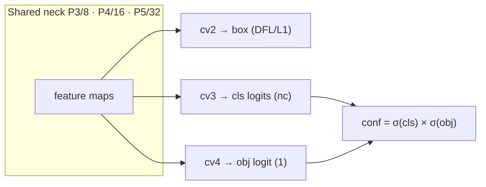
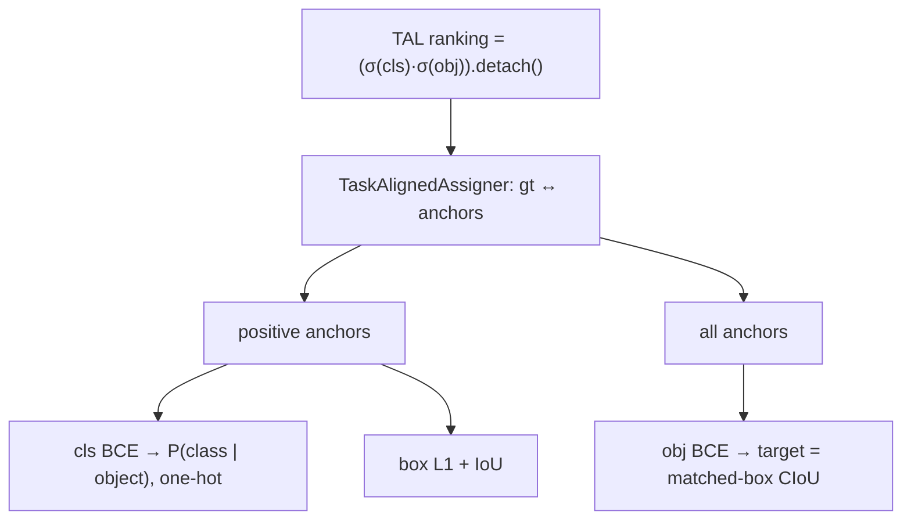
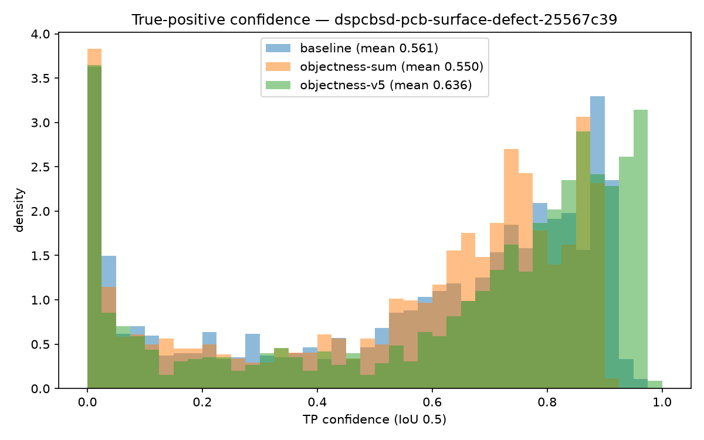
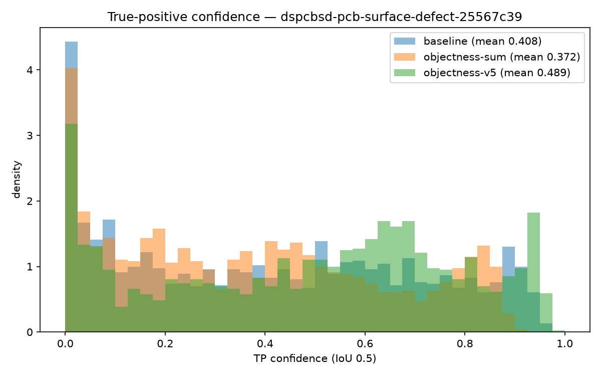
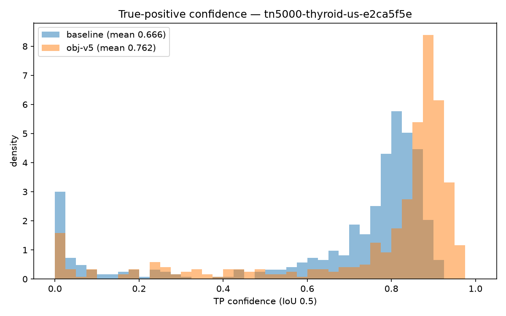
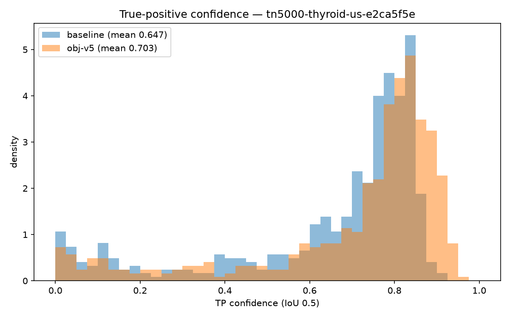

# yolo-objectness

📌 Reintroducing the YOLOv5 **objectness branch** to Ultralytics YOLO (v8 / YOLO11 / YOLO26) as an external package — with YOLOv5's target semantics it reproduces the field claim: **higher confidence (+0.06–0.10 mean TP conf) on similar-looking classes at equal-or-better mAP**, e.g. semiconductor-style defect categories.

Clients reported that YOLO outputs low confidence when categories have similar appearance, and that re-adding the objectness branch removed in v5→v8 helps. This repo is the controlled experiment: the branch re-implemented **without modifying `ultralytics/`**, A/B-tested on 2 hard datasets from the [Ultralytics Benchmark](https://github.com/ultralytics/ultralytics) (37 datasets) under the benchmark protocol.

## How to use this repo

```bash
git clone https://github.com/Laughing-q/yolo-objectness.git
cd yolo-objectness
```

- Requirements: Python ≥ 3.8, PyTorch ≥ 1.8, `ultralytics` (developed against 8.4.215). No new dependencies.
- Always run from the repo root so `objexp` is importable — checkpoints pickle the custom model class.

**Train** — both arms share the benchmark protocol (`train.py`); `--arm` is the only difference:

```bash
python train.py --arm baseline   --data <path/to/data.yaml> --model yolo26n.pt   # stock YOLO
python train.py --arm objectness --data <path/to/data.yaml> --model yolo26n.pt   # + objectness branch
# from-scratch variant: --model yolo26n.yaml
```

**Analyze** — re-validates `best.pt` of each run and writes `report.md`, TP-confidence histograms and confusion matrices:

```bash
python analyze.py --runs baseline=<run_dir> objectness=<run_dir> --out analysis
# any number of arms works: --runs baseline=... obj-sum=... obj-v5=...
```

**Programmatic** — pick any subset of the extensions (all plug into stock engine hooks):

```python
from objexp import ObjDetect, ObjectnessLoss, ObjDetectModel, ObjectnessTrainer
from ultralytics import YOLO

model = YOLO("yolo26n.pt")
model.train(trainer=ObjectnessTrainer, data="data.yaml", epochs=100)  # objectness arm
```

- `ObjectnessTrainer` overrides only `get_model()` (builds `ObjDetectModel`); the validator, predictor and dataloaders are stock.
- `ObjDetectModel.init_criterion()` returns `E2ELoss(self, ObjectnessLoss)` for dual-head models (yolo26) or `ObjectnessLoss(self)` otherwise.
- Loading a trained checkpoint requires `objexp` on the path: `YOLO("runs/.../best.pt")` works from the repo root.

**Top-k class scores per predicted object** — `TopkPredictor` returns the k highest class scores of each detection (sorted descending; column 0 mirrors the final `boxes.cls`/`boxes.conf`), with adjustable `k`:

```python
from functools import partial
from objexp import TopkPredictor, predict_topk

r = predict_topk(model, "img.jpg", k=5)[0]   # convenience wrapper
r.topk_classes  # (num_boxes, k) int tensor — class ids, best first
r.topk_scores   # (num_boxes, k) float tensor — same units as boxes.conf

# or pick the predictor directly
results = model.predict("img.jpg", predictor=TopkPredictor)                  # default k=5
results = model.predict("img.jpg", predictor=partial(TopkPredictor, topk=3))  # k=3
```

- Works with stock and objectness models on the external-NMS path (`nms=None`/`True`); for objectness models scores are `σ(cls)·σ(obj)`, matching `boxes.conf`.
- End-to-end NMS-free outputs (`nms=False`) are already reduced to top-1 before post-processing — falls back to stock behavior with a warning.

## Design

- `ObjDetect(Detect)` — `cv4`/`one2one_cv4` (1-channel objectness convs parallel to the `cv3` cls branch) + `"obj"` key in the head dict; inference emits `conf = σ(cls) · σ(obj)` in the stock `(B, 4+nc, N)` layout, so NMS/validator/predictor are untouched.
- `ObjectnessLoss(v8DetectionLoss)` — TAL assigner ranks on the combined `σ(cls)·σ(obj)`; cls BCE on positive anchors with **one-hot** targets; obj BCE over all anchors regressing matched-box **CIoU** (the YOLOv5 pairing, `yolov5/utils/loss.py`).
- Pretrained transfer reuses the stock intersect-dict load; only the obj branch starts random.





## Experiment results

- Protocol (Ultralytics Benchmark): yolo26n, 100 epochs, seed 0, batch 16, imgsz 640, train ≤ 1000 images (`fraction=[1000, 1.0, 0.0]`), full val, `cls_remap=True`; all other hyps = `cfg/default.yaml`.
- Datasets: **DSPCBSD** (9 near-identical PCB defect classes — closest to the semiconductor client scenario) and **TN5000** (benign/malignant thyroid ultrasound — low contrast, low inter-class discrimination).
- `recall@thr` = recall after discarding detections with `conf < thr` (matched = IoU ≥ 0.5 + correct class).

### Final answer — v5-targets objectness vs stock baseline

| cell | mAP50-95 (base → obj) | mean TP conf (base → obj) | recall@0.5 (base → obj) |
|---|---|---|---|
| DSPCBSD pretrained | 0.396 → **0.397** | 0.561 → **0.636** | 0.601 → **0.660** |
| DSPCBSD scratch | 0.282 → **0.308** | 0.408 → **0.489** | 0.379 → **0.509** |
| TN5000 pretrained | 0.510 → **0.514** | 0.666 → **0.762** | 0.814 → **0.820** |
| TN5000 scratch | 0.478 → **0.487** | 0.647 → **0.703** | 0.788 → **0.832** |

TP confidence histograms at IoU 0.5 (blue = baseline · orange = obj hard-fg targets · green = obj v5 targets):

| | |
|---|---|
|  |  |
|  |  |

### Ablation history (why the target pairing is the key)

**mAP50-95**

| cell | baseline | obj hard-fg/soft-cls | obj + mean-norm loss | obj v5 targets |
|---|---|---|---|---|
| DSPCBSD pretrained | 0.396 | 0.380 | 0.380 | **0.397** |
| DSPCBSD scratch | 0.282 | 0.268 | 0.261 | **0.308** |
| TN5000 pretrained | 0.510 | **0.517** | 0.478 | 0.514 |
| TN5000 scratch | 0.478 | **0.489** | 0.422 | 0.487 |

**mean TP conf**

| cell | baseline | obj hard-fg/soft-cls | obj + mean-norm loss | obj v5 targets |
|---|---|---|---|---|
| DSPCBSD pretrained | 0.561 | 0.550 | 0.503 | **0.636** |
| DSPCBSD scratch | 0.408 | 0.372 | 0.354 | **0.489** |
| TN5000 pretrained | 0.666 | 0.697 | 0.670 | **0.762** |
| TN5000 scratch | 0.647 | 0.616 | 0.562 | **0.703** |

- The original pairing (obj ← hard fg_mask, cls ← TAL soft scores) **hurt** DSPCBSD and merely shifted TN5000's P/R trade — and it is not a pretrained/random-init artifact (same deficit from scratch).
- Mean-normalizing the obj loss is equal-or-worse — the obj-loss scale is not the driver.
- Switching only the targets to the YOLOv5 pairing (obj ← CIoU, cls ← one-hot) turns the branch beneficial in all 4 cells: mAP at/above baseline and confidence up +0.06–0.10, with fewer inter-class confusions on DSPCBSD.
- 💡 Mechanism: CIoU targets give obj a graded localization-quality signal that stays informative after saturation; one-hot cls frees class discrimination from soft IoU-weighted targets. The inverted pairing trains obj on a trivial hard mask while pushing cls toward confounded soft scores.
- Single seed (0) per cell — treat dataset-dependent direction as the finding; the seed sweep is the open follow-up.

Full experiment record (training curves, prediction panels, per-class AP, confusion matrices): [ultralytics-private#219](https://github.com/ultralytics/ultralytics-private/issues/219).

## Repo layout

```
objexp/
├── head.py      # ObjDetect(Detect): cv4/one2one_cv4 objectness convs, conf = σ(cls)·σ(obj)
├── loss.py      # ObjectnessLoss(v8DetectionLoss): v5 targets (obj ← CIoU, cls ← one-hot)
├── model.py     # ObjDetectModel(DetectionModel): head swap + init_criterion
├── trainer.py   # ObjectnessTrainer(DetectionTrainer): get_model override
└── topk.py      # TopkPredictor: top-k class scores per predicted object
train.py         # --arm baseline|objectness, benchmark protocol
analyze.py       # multi-arm val comparison: report.md, TP-conf histograms, confusion
```
